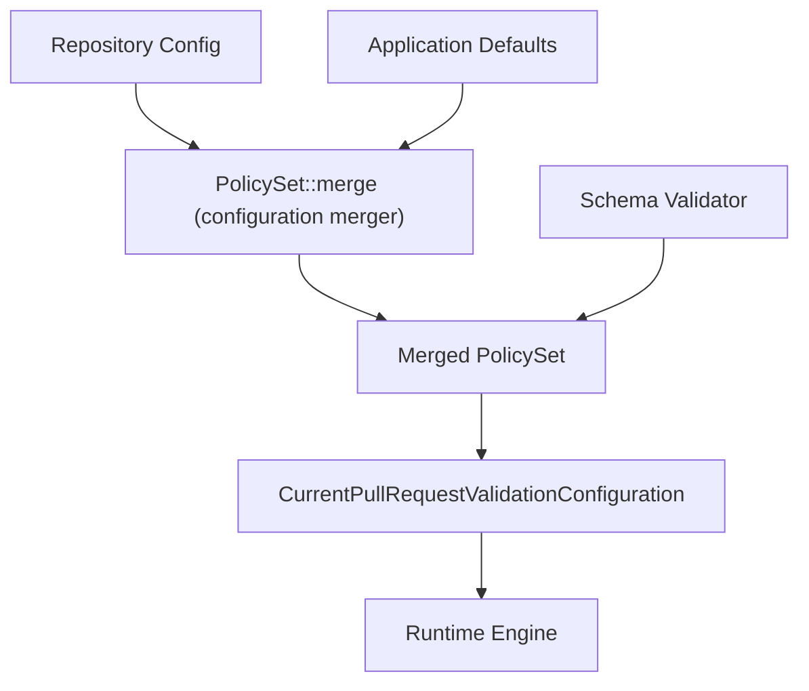
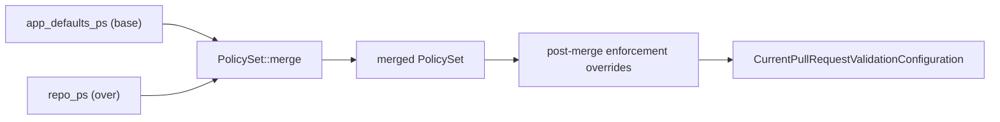

# Configuration System

**Version:** 1.2
**Last Updated:** 2026-11-19

## Overview

The configuration system provides centralized, flexible, and extensible configuration management for Merge Warden across all deployment targets. It supports repository-specific configuration, centralized settings, runtime updates, and comprehensive validation.

## Design Principles

### Configuration as Code

Repository-specific configuration is stored in version control alongside code, enabling configuration changes to be reviewed, tested, and rolled back through standard development workflows.

### Hierarchical Configuration

Configuration is applied in layers with clear precedence rules, enabling both centralized defaults and repository-specific customization.

### Schema Validation

All configuration is validated against a versioned schema to ensure correctness and provide clear error messages for invalid configurations.

### Dynamic Updates

Support for runtime configuration updates without service restarts, enabling operational flexibility and reduced downtime.

## Configuration Architecture



> **Future extension:** When org-level configuration is introduced, two additional tiers feed
> into `PolicySet::merge`: org-level defaults (overriding application defaults) and org-level
> enforced policies (applied last, winning unconditionally).

## Policy Engine

### `PolicySet` — the merge abstraction

All PR validation policies for a single configuration tier are grouped in a `PolicySet`
struct. The 8 constituent configs are:

| Field | Type | Description |
| :--- | :--- | :--- |
| `title` | `PullRequestsTitlePolicyConfig` | Title format, pattern, and missing label |
| `work_item` | `WorkItemPolicyConfig` | Work-item requirement, pattern, and missing label |
| `size` | `PrSizeCheckConfig` | Size thresholds, label prefix, file exclusions |
| `wip` | `WipCheckConfig` | WIP detection patterns and blocking behaviour |
| `pr_state` | `PrStateLabelsConfig` | Draft / review / approved lifecycle labels |
| `issue_propagation` | `IssuePropagationConfig` | Milestone and project propagation settings |
| `change_type_labels` | `ChangeTypeLabelConfig` | Conventional-commit mappings, keyword labels |
| `bypass_rules` | `BypassRules` | Per-rule bypass user lists |
| `renovate_stability` | `RenovateStabilityConfig` | Renovate stability-days label management |

`PolicySet::merge(&self, over: &PolicySet) -> PolicySet` implements "higher-priority `over`
wins for non-default values". Enforcement is achieved by call-site ordering — the enforcing
tier is applied last in the merge chain. See
[ADR-002](../../adr/ADR-002-policy-engine.md) for the full rationale.

### Merge semantics



Per-field merge rules:

| Field type | Rule |
| :--- | :--- |
| Activation `bool` (`required`, `enabled`, `enforce_*`) | `base \|\| over` — once active in either tier, stays active |
| Pattern `String` | `over` wins if non-empty and differs from the type's `default()` value |
| `Option<String>` — optional label | `over.or(base)` |
| `Vec<String>` — label candidates | `over` if non-empty; otherwise `base` |
| Non-activation `bool` | `over` wins unconditionally |
| `HashMap<String, String>` | Per-key: `over` key wins if present |

### Enforcement overrides

Until org-level configuration is supported, four ad-hoc enforcement overrides are applied
after `PolicySet::merge` in `load_merge_warden_config`:

- `app_defaults.enable_title_validation = true` → force `merged.title.required = true`
- `app_defaults.enable_work_item_validation = true` → force `merged.work_item.required = true`
- `app_defaults.pr_size_check.enabled = true` → force `merged.size.enabled = true`
- `app_defaults.wip_check.enforce_wip_blocking = true` → force `merged.wip.enforce_wip_blocking = true`

These will be replaced by the `OrgPolicy.enforced` tier when org-level configuration is introduced.

### Four-tier chain with org-level configuration (planned)

```text
app_defaults_ps
    .merge(&org_defaults_ps)   // org defaults override app defaults
    .merge(&repo_ps)           // repo overrides org defaults
    .merge(&org_enforced_ps)   // org enforced wins unconditionally — applied last
```

Concrete type definitions for `OrgPolicy` are deferred to a future interface spec.

## Configuration Sources

### Repository Configuration

Primary configuration source stored in `.github/merge-warden.toml`:

```toml
schemaVersion = 1

[policies.pullRequests.prTitle]
format = "conventional-commits"
allowed_types = ["feat", "fix", "docs", "chore", "refactor", "test"]

[policies.pullRequests.workItem]
required = true
pattern = "#\\d+"
allowed_prefixes = ["closes", "fixes", "relates to", "references"]

# Opt-in: resolve the matched reference against the configured issue tracker and
# require it to exist and be open. Defaults to false (syntactic check only) — see
# "Work Item Reference Verification" below.
verify_exists = false

# Optional. Omit entirely to verify against GitHub using this repository (the
# zero-configuration default). See "Pluggable Issue Tracker Configuration" below
# for the other four supported trackers.
# [policies.pullRequests.workItem.tracker]
# kind = "github"

[policies.pullRequests.prSize]
enabled = true
fail_on_oversized = false
size_thresholds = { xs = 10, s = 50, m = 100, l = 250, xl = 500 }

[change_type_labels]
enabled = true
create_if_missing = true

# Override the labels applied automatically based on keywords in the PR title/body.
# All fields are optional; omitted fields use the built-in defaults.
[change_type_labels.keyword_labels]
breaking_change = "breaking-change"   # title contains `!:` or body contains "breaking change"
security = "security"                 # body contains "security" or "vulnerability"
hotfix = "hotfix"                     # body contains "hotfix"
tech_debt = "tech-debt"               # body contains "technical debt" or "tech debt"

[policies.bypassRules.title_convention]
enabled = true
users = ["admin", "release-manager"]

[policies.bypassRules.work_items]
enabled = true
users = ["hotfix-team"]

# Renovate stability-days label management.
# Omit this section to use the built-in defaults (enabled = true,
# label = "pr-validation: pending-stability").
[policies.pullRequests.renovateStability]
enabled = true
pending_stability_label = "pr-validation: pending-stability"
```

> **Note:** All three bypass sub-sections (`title_convention`, `work_items`, `size`) are
> optional. A repo that specifies only one category inherits the server-level defaults
> for the other two. A repo that omits the entire `[policies.bypassRules]` block inherits
> all server-level defaults.

### Azure App Configuration

Centralized configuration for operational settings:

```json
{
  "merge-warden:default:enforce_title_convention": "true",
  "merge-warden:default:require_work_items": "true",
  "merge-warden:bypass:emergency_bypass_enabled": "false",
  "merge-warden:monitoring:telemetry_level": "info"
}
```

### Environment Variables

Platform-specific and security-sensitive configuration:

```bash
# Azure Functions
APP_CONFIG_ENDPOINT=https://merge-warden-config.azconfig.io
MERGE_WARDEN_GITHUB_APP_ID=123456
GITHUB_WEBHOOK_SECRET=secret

# CLI
MERGE_WARDEN_CONFIG_PATH=/path/to/config.toml
GITHUB_TOKEN=ghp_token
```

## Configuration Schema

### Schema Versioning

```rust
#[derive(Debug, Deserialize)]
pub struct MergeWardenConfig {
    #[serde(rename = "schemaVersion")]
    pub schema_version: u32,
    pub policies: Option<Policies>,
    pub change_type_labels: Option<ChangeTypeLabels>,
    pub bypass_rules: Option<BypassRules>,
}
```

### Policy Configuration

```rust
#[derive(Debug, Deserialize)]
pub struct Policies {
    #[serde(rename = "pullRequests")]
    pub pull_requests: PullRequestPolicies,
}

#[derive(Debug, Deserialize)]
pub struct PullRequestPolicies {
    #[serde(rename = "prTitle")]
    pub title: Option<TitlePolicy>,
    #[serde(rename = "workItem")]
    pub work_item: Option<WorkItemPolicy>,
    #[serde(rename = "prSize")]
    pub size: Option<SizePolicy>,
}
```

### Validation Rules

```rust
impl MergeWardenConfig {
    pub fn validate(&self) -> Result<(), ConfigurationError> {
        // Schema version compatibility check
        if self.schema_version < MIN_SUPPORTED_VERSION {
            return Err(ConfigurationError::UnsupportedSchemaVersion(
                self.schema_version
            ));
        }

        // Validate policy configurations
        if let Some(policies) = &self.policies {
            policies.validate()?;
        }

        Ok(())
    }
}
```

## Configuration Loading

### Loading Strategy

```rust
pub struct ConfigurationLoader {
    app_config_client: Option<AppConfigurationClient>,
    cache: Arc<Mutex<ConfigurationCache>>,
}

impl ConfigurationLoader {
    pub async fn load_configuration(
        &self,
        repository: &Repository,
    ) -> Result<MergeWardenConfig, ConfigurationError> {
        // 1. Load repository-specific configuration
        let repo_config = self.load_repository_config(repository).await?;

        // 2. Load centralized defaults
        let default_config = self.load_default_config().await?;

        // 3. Apply environment overrides
        let env_overrides = self.load_environment_overrides();

        // 4. Merge configurations with precedence
        let merged_config = self.merge_configurations(
            repo_config,
            default_config,
            env_overrides,
        )?;

        // 5. Validate final configuration
        merged_config.validate()?;

        Ok(merged_config)
    }
}
```

### Caching Strategy

```rust
pub struct ConfigurationCache {
    entries: HashMap<String, CacheEntry>,
    ttl: Duration,
}

impl ConfigurationCache {
    pub fn get(&self, key: &str) -> Option<&MergeWardenConfig> {
        self.entries.get(key)
            .filter(|entry| !entry.is_expired())
            .map(|entry| &entry.config)
    }

    pub fn put(&mut self, key: String, config: MergeWardenConfig) {
        self.entries.insert(key, CacheEntry {
            config,
            expires_at: Instant::now() + self.ttl,
        });
    }
}
```

## Error Handling

### Configuration Errors

```rust
#[derive(Debug, thiserror::Error)]
pub enum ConfigurationError {
    #[error("Unsupported schema version: {0}")]
    UnsupportedSchemaVersion(u32),

    #[error("Invalid configuration: {0}")]
    ValidationError(String),

    #[error("Failed to load repository configuration: {0}")]
    RepositoryConfigError(String),

    #[error("Failed to load App Configuration: {0}")]
    AppConfigError(String),

    #[error("Configuration merge conflict: {0}")]
    MergeConflict(String),
}
```

### Fallback Behavior

```rust
impl ConfigurationLoader {
    async fn load_with_fallback(
        &self,
        repository: &Repository,
    ) -> MergeWardenConfig {
        match self.load_configuration(repository).await {
            Ok(config) => config,
            Err(e) => {
                log::warn!("Failed to load configuration: {}, using defaults", e);
                self.get_safe_defaults()
            }
        }
    }

    fn get_safe_defaults(&self) -> MergeWardenConfig {
        MergeWardenConfig {
            schema_version: CURRENT_SCHEMA_VERSION,
            policies: Some(Policies::default()),
            change_type_labels: Some(ChangeTypeLabels::default()),
            bypass_rules: None,
        }
    }
}
```

## Testing Strategy

### Unit Tests

- Configuration parsing and validation
- Schema compatibility checks
- Merge logic for multiple configuration sources
- Cache behavior and expiration

### Integration Tests

- Repository configuration loading from GitHub
- Azure App Configuration integration
- Environment variable override behavior
- End-to-end configuration loading workflows

### Configuration Test Cases

```rust
#[cfg(test)]
mod tests {
    use super::*;

    #[test]
    fn test_valid_configuration_parsing() {
        let config_toml = r#"
            schemaVersion = 1

            [policies.pullRequests.prTitle]
            format = "conventional-commits"
        "#;

        let config: MergeWardenConfig = toml::from_str(config_toml).unwrap();
        assert_eq!(config.schema_version, 1);
        config.validate().unwrap();
    }

    #[test]
    fn test_invalid_schema_version() {
        let config = MergeWardenConfig {
            schema_version: 0,
            policies: None,
            change_type_labels: None,
            bypass_rules: None,
        };

        assert!(matches!(
            config.validate(),
            Err(ConfigurationError::UnsupportedSchemaVersion(0))
        ));
    }
}
```

## Migration and Compatibility

### Schema Evolution

```rust
pub const CURRENT_SCHEMA_VERSION: u32 = 1;
pub const MIN_SUPPORTED_VERSION: u32 = 1;

// Future schema migrations
impl MergeWardenConfig {
    pub fn migrate_from_v1_to_v2(mut self) -> Self {
        // Example migration logic
        self.schema_version = 2;
        // ... migration transformations
        self
    }
}
```

### Backward Compatibility

The configuration system maintains backward compatibility for at least two major schema versions, with clear deprecation warnings and migration guidance for users.

## Security Considerations

### Sensitive Data Handling

- Secrets (API keys, tokens) are never stored in repository configuration
- Azure Key Vault integration for secure secret management
- Environment variable validation to prevent accidental secret exposure

### Configuration Validation

- Input sanitization for all configuration values
- Regular expression validation for patterns and formats
- Size limits on configuration files and values

## Configuration Change Validation

When a pull request includes changes to `.github/merge-warden.toml`, Merge Warden validates the
proposed configuration and posts an informational comment on the PR. This gives authors immediate
feedback before a broken config reaches the default branch.

### How It Works

1. During `process_pull_request`, the changed-file list is inspected for `.github/merge-warden.toml`.
2. If the file is present, its content is fetched from the PR head SHA using
   `ConfigFetcher::fetch_config_at_ref` — not from the default branch.
3. The content is validated with `validate_config_content(content: &str) -> ConfigValidationOutcome`.
4. A comment identified by `CONFIG_COMMENT_MARKER` (`<!-- MERGE_WARDEN_CONFIG_CHECK -->`) is
   added, updated, or removed according to the validation result.

### `ConfigValidationOutcome`

```rust
pub struct ConfigValidationOutcome {
    /// Whether the configuration parsed and passed schema validation.
    pub valid: bool,
    /// Human-readable error descriptions when `valid` is false.
    pub errors: Vec<String>,
}
```

### Validation Rules Applied

- The TOML content must be parseable as `RepositoryProvidedConfig`.
- `schema_version` must equal `1` (the only currently supported version).
- Structural constraints enforced by `serde` deserialization (unknown fields, type mismatches).

### Comment Behaviour

| Scenario | Comment action |
|---|---|
| Config is valid, no prior comment | No comment posted |
| Config is valid, prior failure comment exists | Delete prior comment |
| Config is invalid, no prior comment | Post failure comment with error list |
| Config is invalid, prior comment identical | No-op (idempotent) |
| Config is invalid, prior comment differs | Delete old comment; post fresh comment |
| PR no longer touches config file | Delete any existing config comment |

### Non-Blocking Guarantee

The config validation result **does not** influence the commit status check conclusion
(`success`, `neutral`, or `failure`). A PR with an invalid `.github/merge-warden.toml`
can still be merged. The comment exists to surface the problem early, not to gate the PR.

This matches the default runtime behaviour: if the file is absent, or cannot be fetched, on
the default branch, Merge Warden falls back to application defaults without blocking
anything. A *malformed* default-branch config can be configured to block — see
[Broken Default-Branch Configuration Policy](#broken-default-branch-configuration-policy)
below; this PR-diff check's non-blocking guarantee is unaffected either way, because it
validates a different artifact (the PR head SHA's copy of the file, not the default
branch's).

## Broken Default-Branch Configuration Policy

The PR-diff validation above only runs when a PR touches `.github/merge-warden.toml`. It
says nothing about the config that is already on the default branch and actually governs
every PR — if *that* file is broken, `resolve_pull_request_config` falls back to an empty
repo tier (application and, if configured, org-level defaults still apply) on every single
PR, silently, with no way for a contributor to find out from the PR diff.
`broken_repo_config_behaviour` closes that gap: an application-level, operator-only setting
that controls whether this condition is surfaced on the PR and whether it blocks.

### Error Classification

Only two `ConfigLoadError` variants count as "broken":

| Variant | Broken? | Rationale |
| :--- | :--- | :--- |
| `Toml(_)` / `ParseError(_)` | Yes | Malformed TOML — the file exists but cannot be parsed |
| `UnsupportedSchemaVersion(..)` | Yes | The file parses but declares a `schemaVersion` this build does not support |
| `NotFound` / `Io(_)` (fetch failure) | No | Transient infrastructure problem, not a config authoring error |
| *(file simply absent)* | No | The documented, supported way to opt out of a repo-tier config entirely |

A fetch failure or an absent file never produces a notice, regardless of
`broken_repo_config_behaviour` — `config.load.failures_total` is still recorded for all
failure kinds (see [Operations monitoring](../operations/monitoring.md)), but only "broken"
configs are eligible for the PR-facing behaviours below.

### `broken_repo_config_behaviour`

```rust
#[derive(Debug, Clone, Copy, PartialEq, Eq, Serialize, Deserialize, Default)]
#[serde(rename_all = "snake_case")]
pub enum BrokenRepoConfigBehaviour {
    #[default]
    SilentFallback,
    Notify,
    Block,
}
```

| Value | PR comment | Check conclusion |
| :--- | :--- | :--- |
| `silent_fallback` (default) | None | Unaffected — identical to pre-existing behaviour |
| `notify` | Posted, explaining the default-branch config could not be loaded | Unaffected |
| `block` | Posted (same comment as `notify`) | Forced to `failure`, overriding `success`, `neutral` (draft PRs), and the unmodified `failure` result alike |

The notice comment uses a dedicated marker, `BROKEN_CONFIG_COMMENT_MARKER`
(`<!-- MERGE_WARDEN_BROKEN_CONFIG_CHECK -->`), kept deliberately distinct from
`CONFIG_COMMENT_MARKER` so the two lifecycles (PR-diff check vs. default-branch notice)
never interfere with each other's reconciliation. It is reconciled on every run: posted when
a notice applies, left untouched when an identical comment already exists, and deleted once
the default-branch config is fixed.

The underlying `ConfigLoadError`'s `Display` text is untrusted — for a malformed-TOML
failure it quotes the repository's own config source lines, which an attacker who can land a
config on the default branch controls. Before being embedded in the comment's fenced code
block, it is passed through a sanitiser that splits any `<!--`/`-->` sequence (so it cannot
forge a marker token that the `body.contains(marker)` reconciler would match) and any triple
back-tick run (so it cannot escape the fence).

### Application-Level Only

`broken_repo_config_behaviour` lives in `ApplicationDefaults` and is read only from
`MERGE_WARDEN_CONFIG_FILE`. It is deliberately **not** part of the `PolicySet` merge chain
described above and has no equivalent field in the per-repository
`.github/merge-warden.toml` schema or in an org policy file's `[defaults]`/`[enforced]`
sections. This is intentional: if a broken repository config could set or override its own
reaction to being broken, the operator's chosen safety net (`notify`/`block`) could be
silently defeated by the very file that is malformed.

## Repository Scope Filtering

Large GitHub organisations can hit GitHub App install-scope limits that prevent an operator
from selecting individual repositories at installation time — past a certain organisation
size, GitHub only offers "All repositories" as an install option. When that happens, Merge
Warden receives webhooks for every repository in the organisation, including ones it was never
intended to act on.

`repository_scope` lets the operator declare, in application-level configuration, which
repositories Merge Warden should actually process — independent of which repositories the
GitHub App installation can technically reach.

### How Repository Scope Filtering Works

`[policies.repository_scope]` is an optional section of the `ApplicationDefaults` TOML
(loaded via `MERGE_WARDEN_CONFIG_FILE`, same as every other `ApplicationDefaults` field, all of
which live under the file's top-level `[policies]` table):

```toml
[policies.repository_scope]
include_patterns = ["payments-*", "checkout", "billing-?"]
exclude_patterns = ["payments-legacy"]
```

- `include_patterns` — glob patterns (`*` = any sequence, `?` = single character) matched
  case-insensitively against the bare repository name. A repository must match at least one
  entry to be processed.
- `exclude_patterns` — glob patterns that take precedence over `include_patterns`. A
  repository matching an exclude pattern is never processed, even if it also matches an
  include pattern. Defaults to an empty list when the key is omitted.
- Omitting the entire `[policies.repository_scope]` section processes every repository — full
  backward compatibility with deployments that predate this feature.
- Setting `include_patterns = []` explicitly processes no repositories at all; this is a
  deliberate fail-closed "pause everything" lever, independent of `exclude_patterns`.

### Not a `PolicySet` Tier

Repository scope filtering is **not** a policy tier and does not participate in the
`PolicySet::merge` chain described above. It is a binary, app-level gate evaluated once per
event, before any repository-specific configuration (org policy, repo config, conditional
policies) is loaded. An out-of-scope repository never reaches `resolve_pull_request_config`
or any part of the merge chain — see
[event-processing.md](../architecture/event-processing.md#repository-scope-filtering) for the
exact point in the pipeline where the check runs.

### Backward Compatibility for Repository Scope Filtering

Because the section is optional and defaults to "process everything" when absent, deployments
that do not set `repository_scope` see no behavioural change.

### Related Types

See [core-config-validation.md](../interfaces/core-config-validation.md#repository-scope-filtering-additions)
for the `RepositoryScope` struct, the `is_repository_in_scope` matching function, and the
`validate_repository_scope_patterns` startup validator.

## Pattern Validation and Compile-Time Safety

`title_pattern` and `work_item_reference_pattern` are maintainer-supplied regular
expressions evaluated against attacker-influenceable input (the title and body of
any pull request). Merge Warden's underlying regex engine matches in linear time
(a Thompson NFA, never backtracking), so the classic catastrophic-backtracking
ReDoS shape that affects backtracking engines does not apply to pattern
*matching*. The residual risk is at pattern *compilation*: a pattern can be
pathologically expensive, or outright fail, to compile into the engine's internal
program, and today there is no application-level control over that boundary and
no distinct, documented behaviour when it is crossed.

### Validation Rule

Every pattern string — whether set in application defaults, an org policy file,
or a repository's own `.github/merge-warden.toml` — must satisfy a fixed length
cap and compile within a fixed compiled-program size budget before it is accepted
as part of a valid configuration:

- **Length cap**: patterns longer than a fixed maximum are rejected without an
  attempt to compile them.
- **Bounded compile budget**: patterns within the length cap are compiled with an
  explicit size limit well below the regex engine's own default, so a
  syntactically valid but pathologically expensive pattern is rejected quickly
  and deterministically.
- Both limits are **fixed application constants**. They are not configurable per
  repository or org — the entity whose pattern is being bounded must not be able
  to raise its own bound. See
  [ADR-006](../../adr/ADR-006-regex-pattern-validation.md).

### When Validation Runs

Validation happens once, at the point each configuration tier is parsed — never
lazily on first use during webhook processing:

| Configuration tier | Validation point |
|---|---|
| Application defaults | Server/CLI startup (`load_config()`), alongside existing startup validation such as `validate_repository_scope_patterns` |
| Org policy | Each time `load_org_policy` fetches and parses the org policy file |
| Repository config (effective/default-branch) | Each time `load_merge_warden_config` / `resolve_pull_request_config` resolves the configuration for an incoming webhook event |
| Repository config (PR-diff, informational) | `validate_config_content`, as an additional rule alongside the existing TOML/`schemaVersion` validation (see [Configuration Change Validation](#configuration-change-validation) above) |

A successfully validated pattern is compiled exactly once per configuration
resolution; a process-wide cache keyed by the pattern string additionally avoids
recompiling byte-identical patterns across webhook events and across
repositories that share a pattern (most repositories use at least one built-in
default). See
[core-config-validation.md](../interfaces/core-config-validation.md#regex-pattern-validation-and-compilation)
for the concrete types (`validate_pattern`, `CompiledPatternCache`,
`PatternValidationError`, `MAX_PATTERN_LENGTH`, `PATTERN_COMPILE_SIZE_LIMIT`).

### Deterministic, Maintainer-Visible Failure — Never Silent

When a configured pattern fails validation on the path that actually governs PR
evaluation, this is treated as a distinct, deterministic failure of the specific
check that depends on it (title or work item), never as a silent disablement and
never as a silent fallback to a different tier's pattern:

- The dependent check (and only that check — the other check is unaffected) is
  reported as **failed**, with a message that explicitly names the configuration
  problem (e.g. "the configured pattern is invalid and could not be evaluated"),
  distinct from "the title/body did not match the pattern."
- This message is surfaced through the same maintainer-visible channel already
  used for that check's ordinary feedback — check-run output and/or a PR comment
  — because the repository maintainer, not the operator, is the person who can
  fix the pattern. No new comment marker or communication path is introduced.
- There is no configuration option to silence this failure or fall back to a
  different tier's pattern. This is intentionally stricter than
  `broken_repo_config_behaviour` (which *is* configurable): a malformed TOML file
  has a safe degraded state (use application defaults), but "the pattern this
  check depends on cannot be evaluated" has no safe default other than failing
  that check.
- On the PR-diff informational path (`validate_config_content`), an invalid
  pattern is added to `ConfigValidationOutcome.errors` exactly like any other
  schema problem, and remains subject to that check's existing non-blocking
  guarantee.

## Work Item Reference Verification

By default, the work-item check is **syntactic only**: it passes as soon as the
PR title/body contains text matching `work_item_reference_pattern`, with no
confirmation that the referenced work item exists, let alone that it reflects
real, current work. `#99999` passes exactly as readily as a reference to a real,
open issue. This is a formatting/hygiene control, not a traceability control, and
is the default because it requires no additional permissions or external calls
beyond what the check already does.

### `verify_exists`

Setting `verify_exists = true` on `[policies.pullRequests.workItem]` opts into
live verification: the reference extracted by the pattern match is resolved
against the configured issue tracker, and the check additionally requires that
the work item **both exists and is open**. A reference to a work item that exists
but has since been closed fails the check identically to a reference that does
not resolve at all — see
[ADR-007](../../adr/ADR-007-issue-tracker-abstraction.md) for why "valid" is
defined as a single exists-and-open condition rather than two independently
toggleable conditions.

- Default: `false`. When unset, behaviour is unchanged from the syntactic-only
  check described above.
- Requires read access to the configured tracker. For the default (GitHub)
  tracker this is the `Issues: Read` repository permission the GitHub App already
  holds for milestone/project propagation (see
  [Issue Metadata Propagation](./issue-metadata-propagation.md)) — enabling
  `verify_exists` with the default tracker requires no new permission grant.
- Cross-repository/cross-project references are **resolved** against the
  referenced project when the configured credential can reach it and the
  tracker's reference syntax can express a cross-project target in the first
  place (today, that is GitHub's `owner/repo#42` and, where a maintainer's
  pattern captures it, GitLab's equivalent — Jira, Azure DevOps, and Linear have
  no cross-project reference concept in this design). When the target cannot be
  reached (or the item does not exist), the reference is treated as unresolved,
  which fails the check under `verify_exists` exactly like any other unresolved
  reference. Verification is never silently skipped for a cross-repository
  reference.
- Verification failures (tracker unreachable, authentication rejected) are
  reported with a message distinguishable from "reference does not exist" and
  from "reference exists but is closed" — e.g. *"could not verify work item
  reference: issue tracker is currently unreachable; this check will be
  re-evaluated if the pull request is updated or the check is re-run"* — so
  maintainers can tell a tracker outage apart from an actually-invalid
  reference. This is a deliberate fail-closed trade-off: a tracker outage can
  block merges while `verify_exists` is enabled, with no neutral/pass-through
  fallback. A maintainer who hits this routinely can disable `verify_exists`,
  since it is opt-in.
- Resolution results are cached in-memory, per process, for a short, fixed TTL
  so repeated webhook events against the same PR (e.g. several `synchronize`
  events as fixup commits land) do not repeatedly re-contact the tracker for a
  reference that has not changed. A fixed cap also bounds how many distinct
  references a single PR event resolves, so a PR body crafted with many
  reference-shaped strings cannot trigger unbounded outbound calls.

See [Work Item Reference Verification types](../interfaces/issue-tracker.md) for
the full behavioural contract.

## Pluggable Issue Tracker Configuration

The work item a PR references does not have to live in the same system that
hosts the PR. A repository selects its tracker via an optional
`[policies.pullRequests.workItem.tracker]` table:

```toml
[policies.pullRequests.workItem]
required = true
pattern = "#\\d+"
verify_exists = true

# Omit this table entirely to verify against GitHub using this repository —
# the zero-configuration default, reusing the existing installation credential.
[policies.pullRequests.workItem.tracker]
kind = "github"
```

Five trackers are supported: GitHub, Azure DevOps (both the `dev.azure.com` cloud
service and on-premises Azure DevOps Server), Jira (Cloud and Server/Data
Center), GitLab (gitlab.com and self-managed), and Linear.

For every tracker other than GitHub, the repository config supplies only `kind`,
a `profile` naming an operator-defined connection (see "Operator-Defined Tracker
Profiles" below), and project-scoping identifiers that select which
project/org/team *within* that already-fixed connection to query —
`organization`/`project` for Azure DevOps, `project_key` for Jira, `project_path`
for GitLab, `team_key` for Linear:

```toml
[policies.pullRequests.workItem.tracker]
kind = "jira"
profile = "jira_support"   # names a profile defined in the operator's application config
project_key = "PROJ"
```

A repository or org config file cannot supply a connection's `base_url` or
`auth_token_env` directly — see "Operator-Defined Tracker Profiles" below for why
and where those fields live instead.

The abstraction is deliberately extensible: adding a sixth tracker means adding
one new `TrackerConfig` variant and one new adapter module, with no change to the
check logic in `core`. See
[issue-tracker.md](../interfaces/issue-tracker.md) for the trait, the
tracker-agnostic data model, the full field reference per tracker, the
project-scoping identifier charset requirements, and the open/closed
state-mapping table each adapter is responsible for. See
[Tracker Connection Configuration and Outbound Request Risk](../security/threat-model.md#tracker-connection-configuration-and-outbound-request-risk)
for the security considerations this split between operator profile and
repository config exists to address.

### Tracker/Pattern Alignment

Selecting a non-GitHub tracker while leaving `work_item_reference_pattern` at its
built-in, GitHub-shaped default (`#\d+`-style) means that tracker's reference
syntax (a Jira key, an Azure DevOps ID, a Linear identifier) can never match the
pattern, so `verify_exists` would always fail silently against a pattern that
was never going to match. Configuration validation rejects this combination at
config-load time with a clear error naming the mismatch, rather than inferring
or auto-selecting a pattern for the chosen tracker — the maintainer must set an
explicit pattern matching the tracker's own reference syntax. See
[core-config-validation.md](../interfaces/core-config-validation.md) for the
concrete validation rule.

### Operator-Defined Tracker Profiles

Tracker connection coordinates — `base_url` and the name of the environment
variable holding the credential (`auth_token_env`) — are **never** set in a
repository's or org's own configuration file. They are defined exclusively in
the operator's application configuration, under `[policies.tracker_profiles.<name>]`
(`ApplicationDefaults.tracker_profiles`), the same trust tier
`broken_repo_config_behaviour` (see
["Broken Default-Branch Configuration Policy"](#broken-default-branch-configuration-policy))
and `repository_scope` already live in:

```toml
# Server application config — [policies] maps to ApplicationDefaults
[policies.tracker_profiles.jira_support]
kind = "jira"
base_url = "https://my-team.atlassian.net"
auth_token_env = "JIRA_API_TOKEN"

[policies.tracker_profiles.ado_internal]
kind = "azure_devops"
base_url = "https://my-ado-server.internal.example.com"   # on-prem Server
auth_token_env = "ADO_PAT"
```

A repository's `[policies.pullRequests.workItem.tracker]` table names one of
these profiles by its key (`profile = "jira_support"`) and supplies only the
project-scoping identifiers described above. At config-resolution time the named
profile is looked up and its `kind` must match the repository's selected `kind`
exactly — a mismatch, or a `profile` name that does not exist in
`tracker_profiles`, is a config validation error, fail-closed and
maintainer-visible, exactly like an unknown or oversized pattern (ADR-006) or a
broken default-branch config (ADR-005).

This split exists because a repository's own config file is not a trusted
boundary for an outbound connection target and a credential pointer together: a
repository-controlled `base_url` pointed at an attacker-controlled host, paired
with a repository-controlled `auth_token_env` naming an unrelated secret (e.g.
the application's own GitHub private key or webhook secret), would let a
malicious or careless config change exfiltrate that secret to that host. Keeping
both fields operator-only, and letting the repository control only which
already-fixed connection's project/org/team to query, closes that vector
entirely — see
[ADR-007](../../adr/ADR-007-issue-tracker-abstraction.md) and
[Tracker Connection Configuration and Outbound Request Risk](../security/threat-model.md#tracker-connection-configuration-and-outbound-request-risk).

## Related Specifications

- [Validation Engine](./validation-engine.md) - How configuration drives validation behavior
- [Operations Configuration Management](../operations/configuration-management.md) - Operational configuration procedures
- [Security Data Protection](../security/data-protection.md) - Secure handling of configuration data
- [Functional Requirements FR-007](../requirements/functional-requirements.md#fr-007-configuration-change-validation) - Acceptance criteria for this feature
- [Functional Requirements FR-010](../requirements/functional-requirements.md#fr-010-broken-default-branch-configuration-policy) - Acceptance criteria for the broken default-branch configuration policy
- [Functional Requirements FR-011](../requirements/functional-requirements.md#fr-011-regex-pattern-validation-and-deterministic-failure-handling) - Acceptance criteria for pattern validation and compile-failure handling
- [Functional Requirements FR-012](../requirements/functional-requirements.md#fr-012-work-item-reference-verification) - Acceptance criteria for work item reference verification
- [Functional Requirements FR-013](../requirements/functional-requirements.md#fr-013-pluggable-issue-tracker-support) - Acceptance criteria for multi-tracker support
- [Issue Tracker Abstraction](../interfaces/issue-tracker.md) - Trait, types, and per-tracker configuration
- [ADR-006](../../adr/ADR-006-regex-pattern-validation.md) / [ADR-007](../../adr/ADR-007-issue-tracker-abstraction.md) - Design rationale
